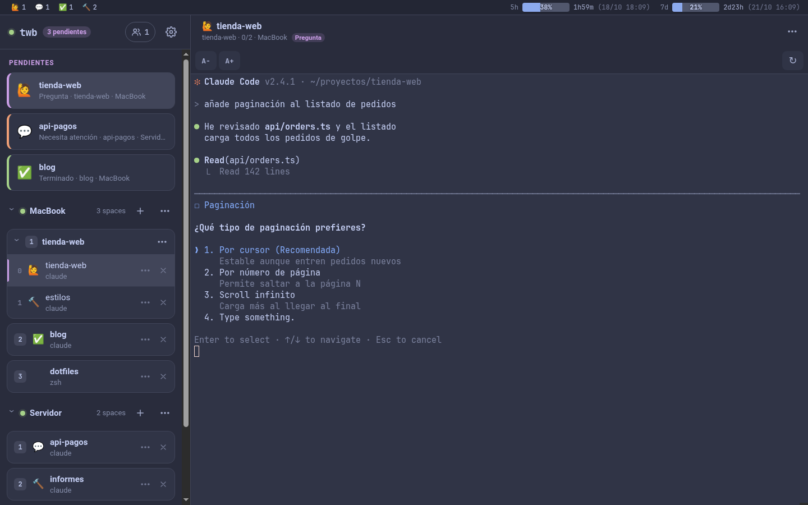
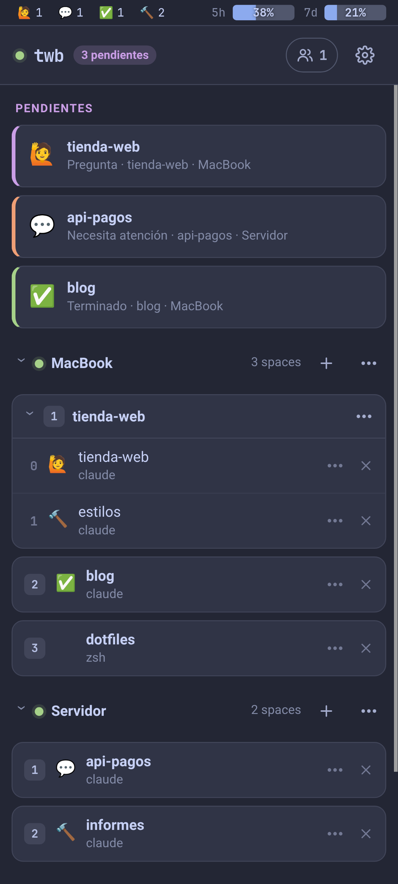
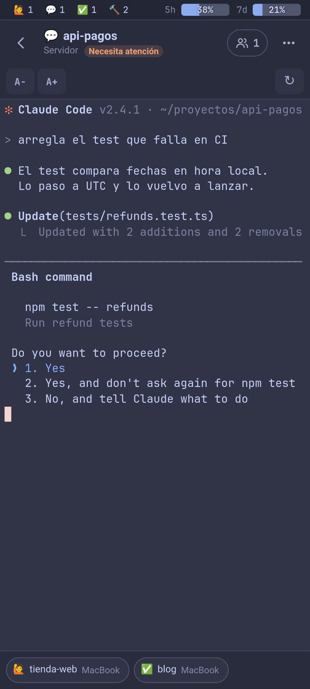
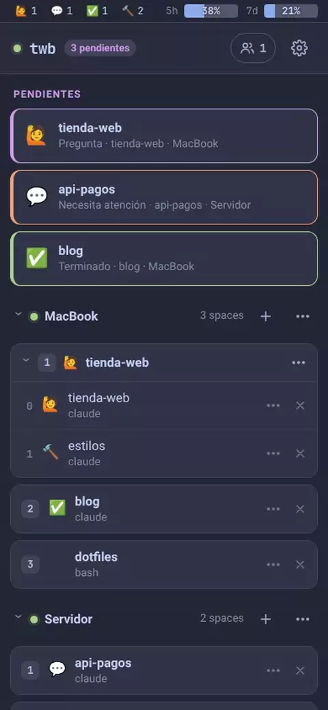
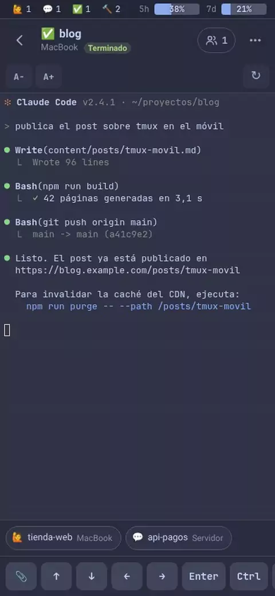

# tmux web bridge

Panel web (**twb**) para usar tus sesiones de tmux, y los agentes de Claude Code que corren en ellas, desde el móvil o desde cualquier otro equipo. Solo dentro de tu tailnet de Tailscale o de tu LAN.



<p align="center">
  
  &nbsp;&nbsp;
  
</p>

- **Pendientes primero.** Los Claude que te esperan (🙋 pregunta, 💬 permiso, ✅ terminado) salen arriba, de todas las máquinas.
- **Vista de ventanas**: todas las ventanas abiertas en miniatura y en vivo, con sus paneles y titulada «space › ventana». Un toque abre la que quieras.
- **Terminal completa** (xterm.js) con barra de teclas para el móvil. Cada pestaña tiene su propia ventana actual, así que navegar desde el móvil no mueve el tmux del ordenador.
- **Seleccionar y copiar con el dedo**: pulsación larga, asas para ajustar cada extremo y una lupa sobre el dedo.
- **Control completo** de spaces, ventanas y paneles; «Nuevo space» puede abrir un proyecto y arrancar `claude` en él.
- **Notificaciones push** (Web Push) con el texto de la pregunta, y botones para responder desde la propia notificación.
- **Varias máquinas** (macOS, Linux, WSL) desde un único servidor central, por SSH.
- **Límites de uso** de Claude (5 h y semanal) y quién está conectado al panel, siempre a la vista.

## En el móvil

<table>
  <tr>
    <td align="center" width="33%"><a href="docs/videos/navegar.webm"></a></td>
    <td align="center" width="33%"><a href="docs/videos/responder.webm"></a></td>
    <td align="center" width="33%"><a href="docs/videos/seleccionar.webm"></a></td>
  </tr>
  <tr>
    <td align="center"><b>Moverse</b><br>De un pendiente a su ventana, deslizar la cabecera para cambiar de ventana y el borde para abrir el cajón.</td>
    <td align="center"><b>Responder</b><br>Flechas y Enter de la barra de teclas para contestar a Claude.</td>
    <td align="center"><b>Seleccionar y copiar</b><br>Pulsación larga, lupa, asas y botón «Copiar».</td>
  </tr>
</table>

Toca un vídeo para verlo a más resolución (WebM).

## Cómo funciona

```
 móvil / PC ──HTTPS──▶ servidor central (Node + Fastify + node-pty, :7681)
                         ├── tmux local ........ (opcional)
                         └── ssh <máquina> ──▶ tmux    (una conexión por máquina)
 cada máquina: hooks de Claude ──POST /api/notify──▶ servidor central ──Web Push──▶ móvil
```

El servidor central lee el árbol de tmux de cada máquina cada segundo y lo manda a los navegadores por WebSocket. Cada terminal es una sesión de tmux agrupada (`_tw-*`) que se destruye al cerrar la pestaña. Los estados salen de las opciones `@pane_icon`/`@win_icon` que pone el kit de cada máquina.

| Carpeta | Contenido |
| --- | --- |
| `server/` | Servidor central (TypeScript, Fastify, node-pty, web-push) |
| `web/` | App web (Preact, xterm.js), instalable como PWA |
| `shared/` | Tipos compartidos |
| `host-kit/` | Kit de cada máquina: estados de Claude, spaces, status line, hooks e instalador |
| `deploy/` | Instalación del servidor central (systemd o Docker) |

## Instalación

### 1. Servidor central

Necesita un Linux siempre encendido. Hay dos formas:

- **Con systemd y `tailscale serve`** (Node.js 22+, `build-essential`, `python3`, `ssh`):
  ```sh
  git clone https://github.com/SantiagoSchez/tmux-web-bridge.git ~/tmux-web-bridge
  ~/tmux-web-bridge/deploy/install-hub.sh
  ```
  Compila, crea `config.yaml` con un `notifyToken` aleatorio, genera la clave SSH e instala el servicio de usuario. Después: pon tus máquinas en `config.yaml`, activa `sudo loginctl enable-linger $USER` y publica con `sudo tailscale serve --bg 7681`. Se entra con tu identidad de Tailscale, sin contraseña.
- **Con Docker, detrás de tu proxy y con contraseña** (por ejemplo, en un LXC de Proxmox). Así funciona también desde la LAN sin Tailscale:
  ```sh
  mkdir -p ~/docker/stacks/twb && cd ~/docker/stacks/twb
  git clone https://github.com/SantiagoSchez/tmux-web-bridge.git app
  cp app/deploy/docker/compose.yaml . && cp app/config.example.yaml config.yaml
  mkdir -p data ssh tailscale/state && chmod 700 ssh
  ssh-keygen -t ed25519 -N '' -C twb -f ssh/id_ed25519
  docker compose run --rm -it twb node server/dist/index.js hash-password   # → auth.passwordHash
  printf 'TS_HOSTNAME=mi-twb\nTS_AUTHKEY=tskey-auth-...\nTWB_BIND=10.0.0.5\n' > .env && chmod 600 .env
  docker compose up -d --build
  ```
  Tailscale va como contenedor auxiliar (modo userspace) y el servidor central entra a las máquinas por su proxy SOCKS5. Los detalles están comentados en `compose.yaml` y `config.example.yaml`. En el proxy, admite WebSocket y sube `proxy_read_timeout`, porque las terminales pasan horas abiertas.

### 2. Acceso SSH a cada máquina

Añade la clave pública del servidor central a `~/.ssh/authorized_keys` de cada máquina, limitada a su IP:

```
from="100.x.y.z" ssh-ed25519 AAAA... twb
```

Hace falta tmux 3.2 o posterior. En Linux, activa también `loginctl enable-linger`; sin él, systemd mata tus sesiones de tmux al cerrarse la última conexión SSH. En WSL, instala Tailscale dentro de la distro o usa `networkingMode=mirrored`.

### 3. Kit de cada máquina

En cada máquina con Claude Code:

```sh
git clone https://github.com/SantiagoSchez/tmux-web-bridge.git ~/tmux-web-bridge
~/tmux-web-bridge/host-kit/install.sh --hub https://<url-del-panel> --host <id-en-config.yaml> --token <notifyToken>
```

Enlaza los scripts de estados de Claude, de spaces y la status line; añade un `source-file` a tu `~/.tmux.conf`, fusiona los hooks en `~/.claude/settings.json` y guarda lo propio de la máquina en `~/.config/tmux-web-bridge/notify.env`. Lo que hubiera antes se guarda en `.bak.<fecha>`. Los enlaces son relativos y el `source-file` usa `~`, así que valen aunque `~/.scripts` o `~/.tmux.conf` vivan en unos dotfiles compartidos entre máquinas, siempre que todas tengan el clon en `~/tmux-web-bridge`. Si Claude Code usa otra carpeta de configuración, `--claude-dir` (o `CLAUDE_CONFIG_DIR` al instalar); se recuerda para los siguientes `git pull`. Para actualizar basta un `git pull` en el clon: un hook de git vuelve a aplicar el kit. Con `install.sh --check` se comprueba la conexión.

<details>
<summary>Usar tu propia status line en vez de la del kit</summary>

El panel saca los límites de uso de una opción global de tmux que publica la status line (Claude Code solo le pasa `rate_limits` a ella). Si instalas con `--skip-claude`, añade esto a la tuya después de leer el JSON en `$input`:

```bash
# Límites de uso para el panel web (tmux-web-bridge): "pct5h reset5h pct7d reset7d actualizado"
if [ -n "$TMUX" ]; then
  read -r P5 R5 P7 R7 < <(echo "$input" | jq -r '[(.rate_limits.five_hour.used_percentage // 0 | floor), (.rate_limits.five_hour.resets_at // 0), (.rate_limits.seven_day.used_percentage // 0 | floor), (.rate_limits.seven_day.resets_at // 0)] | @tsv')
  if [ "${R5:-0}" -gt 0 ]; then
    RL_OLD=$(tmux show-options -gqv @claude_rate_limits 2>/dev/null)
    [ "${RL_OLD% *}" = "$P5 $R5 $P7 $R7" ] || tmux set-option -gq @claude_rate_limits "$P5 $R5 $P7 $R7 $(date +%s)"
  fi
fi
```
</details>

### 4. En el móvil (Android)

Abre la URL del panel en Chrome, **Añadir a pantalla de inicio**, y en ⚙️ **Ajustes › Notificaciones › Activar en este dispositivo**.

## Seguridad

- Dos formas de entrar, nunca mezcladas (`auth.method`):
  - `tailscale`: solo por `tailscale serve`, con la cabecera `Tailscale-User-Login` y la lista `auth.allowedLogins`.
  - `password`: detrás de cualquier otro proxy, con hash scrypt, cookie `HttpOnly`, límite de intentos, verificación en dos pasos opcional (TOTP) y cierre remoto de sesiones. Las cabeceras de Tailscale se ignoran.
- La API y los WebSocket exigen sesión y mismo origen; `/api/notify` exige el `notifyToken`.
- El servidor central entra en las máquinas con su propia clave, limitable con `from=`. `config.yaml`, `notify.env` y las claves VAPID se guardan con permisos 600.

## Desarrollo

```sh
pnpm install
cp config.example.yaml config.yaml   # con allowWithoutTailscale: true y un host local: true
pnpm --filter web build && ./restart-dev.sh     # http://127.0.0.1:7681 (log en server-dev.log)
pnpm typecheck
```

## Solución de problemas

| Síntoma | Causa probable |
| --- | --- |
| Una máquina sale «sin conexión» | Pasa el ratón (o toca) «sin conexión» para ver el error de ssh, y prueba `ssh` a mano desde el servidor central. Sus spaces dejan de mostrarse al minuto sin respuesta, porque ya no se sabe qué tiene abierto. |
| No llegan notificaciones | ⚙️ Ajustes › Enviar prueba; `host-kit/install.sh --check` en la máquina. |
| 401 al abrir el panel | Con `auth.method: tailscale`, estás entrando sin `tailscale serve`. |
| «Código incorrecto» en la verificación en dos pasos | La hora del móvil o del servidor va desfasada más de 30 s. |
| `posix_spawnp failed` | Permisos del `spawn-helper` de node-pty: `node scripts/fix-node-pty.mjs`. |
